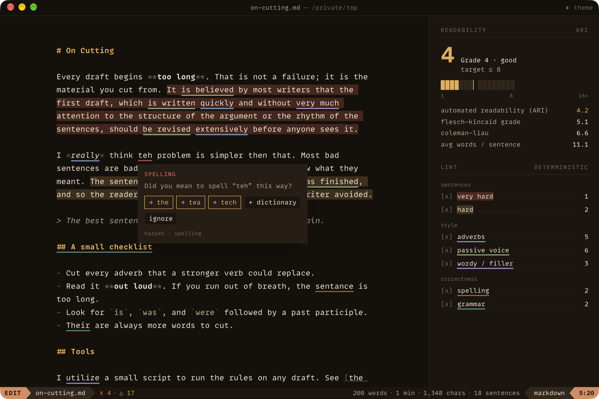

<p align="center">
  
</p>

<h1 align="center">Steinbeck</h1>

<p align="center">
  <em>A quiet markdown editor that tells you the truth about your sentences.</em>
</p>

<p align="center">
  
</p>

Steinbeck is a native macOS markdown editor with two modes:

- **Write mode** shows only your text. There are no marks and no sidebar.
- **Edit mode** (`⌘E`) marks the problems in your prose and shows a readability score.

Steinbeck does not write for you. It shows where the writing is weak, and you fix it.

## Install

You need [Bun](https://bun.sh) and [Rust](https://rustup.rs). Then run one command:

```sh
bun run setup
```

This command:

1. Installs the dependencies and builds a release version of the app.
2. Copies `Steinbeck.app` to `/Applications` (or `~/Applications` if you cannot write to
   `/Applications`).
3. Adds a `steinbeck` shell function to `~/.zshrc`, between `# >>> steinbeck >>>` marker lines. If
   you run setup again, it replaces that block. It does not add a second one.

Open a new terminal, then:

```sh
steinbeck draft.md        # open a file (Steinbeck creates it if it does not exist)
steinbeck a.md b.md       # open more than one file
steinbeck                 # open the app
```

To update, pull the latest code and run `bun run setup` again.

## What edit mode shows

| Mark                | Meaning                                                  |
| ------------------- | -------------------------------------------------------- |
| Yellow background   | Hard sentence: it scores grade 10–13 on its own          |
| Red background      | Very hard sentence: grade 14 or higher                   |
| Blue underline      | Adverb. Use a stronger verb, or cut it                   |
| Green underline     | Passive voice                                            |
| Purple underline    | Wordy phrase or filler, often with a simpler alternative |
| Red wavy underline  | Spelling (from [Harper](https://writewithharper.com))    |
| Teal wavy underline | Grammar (from Harper)                                    |

Click a mark to see the problem and its fixes. A spelling error also has `+ dictionary`. Hover a
category in the sidebar to show only its marks. Click the category to turn it off.

The readability score is the [Automated Readability Index][ari]. It counts characters, not
syllables, so the same text always gets the same score. Hover any number in the sidebar to see what
it means.

Steinbeck analyzes only prose. It ignores code blocks, inline code, URLs, raw HTML, and YAML front
matter.

[ari]: https://en.wikipedia.org/wiki/Automated_readability_index

## Keyboard shortcuts

| Keys  | Action                   |
| ----- | ------------------------ |
| `⌘E`  | Switch write / edit mode |
| `⌘O`  | Open                     |
| `⌘S`  | Save                     |
| `⌘⇧S` | Save as                  |
| `⌘N`  | New document             |
| `⌘F`  | Find and replace         |
| `Esc` | Close the issue popover  |

## Develop

```sh
bun install
bun run tauri dev         # app with hot reload (Vite on http://localhost:1420)
bun run validate          # format, lint, type check, tests, cargo fmt/clippy/test
bun run bench:rust        # analysis speed on a 4,500-word document, release build
```

| Path                     | Contents                                                      |
| ------------------------ | ------------------------------------------------------------- |
| `src/`                   | Frontend: Solid 2, Tailwind 4, CodeMirror 6                   |
| `src/editor/`            | Editor setup, theme, and the marks that follow your edits     |
| `src-tauri/src/analysis` | Analysis engine: prose extraction, style rules, Harper, stats |
| `src-tauri/src/`         | Tauri commands, user dictionary, files opened from macOS      |
| `scripts/setup.ts`       | The `bun run setup` installer                                 |
| `scripts/render-icon.ts` | Renders `assets/icon.svg` and generates all icon sizes        |
| `design/mockup.html`     | The original design mockup. Open it in a browser              |

### Backend notes

The analysis engine keeps a cache of each top-level markdown block, so an analysis after one edit
takes about 8 ms. User dictionary words are in
`~/Library/Application Support/com.helvetici.steinbeck/dictionary.txt`, one word on each line.

The app opens `.md` and `.markdown` files from Finder ("Open With"), from
`open -a Steinbeck file.md`, and from file paths given as command-line arguments.

### Regenerate the icons

Edit `assets/icon.svg`, then run `bun run icons`. This renders `assets/icon.png` and writes all
sizes into `src-tauri/icons/`. Commit the SVG, the PNG, and the generated icons.
